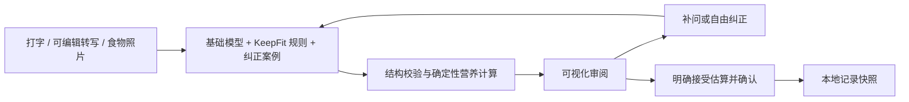

# KeepFit 工作台与服务设计 · 0.3.0

2026-10-22。用户已授权接入 DeepSeek 或 MiMo 进行小额真实试用。此版本在 0.1.0 本地服务基础上加入工作台、真实平台适配和可视化调教。

## 流程

食物照片使用视觉模型理解画面，不能只做 OCR。后续补问复用结构化观察，原图不持久化、不重复上传。语音转写由浏览器或设备系统提供，工作台后端不接收原始音频。

## 专门的饮食理解规则

`cloud.py` 的 `BASE_RULES` 包含本人实吃、否定排除、改口覆盖、扣除剩余、共餐不自动均分、成品菜不与原料重复计算、份量估算依据、未知不当零、时间解释、多轮保留和来源标注。用户自定义规则与最近 6 条启用案例加入同一次请求。

这不是参数微调。记录保存的模型提供方、基础模型和规则版本用于解释来源，不能当作训练完成证明或准确率保证。营养处理优先精确匹配 `food_database`（USDA22种基础食物），其次 `recipe_estimate`（8种公开配方假设），再保留 `model_estimate` 或 `unknown`。`nutrition_source` 提供来源、版本、配方组成与估算备注。

## 真实平台请求

| 平台 | 固定服务地址 | 模型 | 输出上限字段 |
|---|---|---|---|
| DeepSeek | `https://api.deepseek.com` | `deepseek-flash` | `max_tokens` |
| MiMo | `https://api.xiaomimimo.com/v1` | `mimo-v2.6-flash` | `max_completion_tokens` |

使用 `/chat/completions`，JSON mode，关闭 thinking，最多输出 4096 tokens。文本、转写、图片都使用统一的 `Understanding` 结构；JSON 返回后还要经过本地 Pydantic 校验，不因为供应商 JSON mode 成功就认为语义或营养正确。

连接时调用 `/models` 检查密钥及所选模型可用性，不发起推理。仅用户操作触发推理，每轮默认 10 次；失败请求也计入次数，避免假定供应商未计费。没有自动重试、自动评测或后台推理。模型调用不持有 SQLite 写事务，页面可以读取状态；本地原型仍串行执行推理，不支持生产规模的并发任务。

官方依据：[DeepSeek JSON 输出](https://api-docs.deepseek.com/guides/json_mode/)、[DeepSeek Chat API](https://api-docs.deepseek.com/api/create-chat-completion/)、[MiMo Chat API](https://mimo.mi.com/docs/en-US/api/chat/openai-api)、[MiMo 结构化输出](https://mimo.mi.com/docs/en-US/quick-start/usage-guide/text-generation/structured-output)、[浏览器语音接口与兼容性](https://developer.mozilla.org/en-US/docs/Web/API/SpeechRecognition)。模型名和协议于本次开发核验，实际识别效果仍需真实试用验证。

## 接口

保留创建草稿、读取、回答问题、确认和读取记录的 `/v1/intakes` / `/v1/records` 接口，新增：

- `POST /v1/intakes/{id}/revise`：自然语言纠正，携带 `expected_revision`，返回完整新版本。
- `GET /v1/workbench/state`：连接状态、规则、纠正案例和近期记录；不返回密钥。
- `POST /v1/workbench/connect` / `disconnect`：验证连接或清除内存密钥。
- `POST /v1/workbench/extend-trial`：明确增加下一轮 10 次试用额度。
- `POST /v1/workbench/rules`：保存带版本的理解偏好。
- `POST /v1/workbench/feedback`：保存关联草稿版本的纠正案例。
- `POST /v1/workbench/feedback/{id}/delete`：删除当前调用方的纠正案例。

营养记录仍须 `needs_clarification` → `ready_for_confirmation` → `confirmed`。确认后不可继续修改原快照。已确认记录可以保存纠正案例供将来参考，要重新识别则新建草稿。SwiftUI App 在确认后原子写入 FoodLog，按记录与条目ID去重并保存来源；尚未实现跨设备云同步或修改已确认模型快照。

`totals=null` 表示整餐信息不足；`known_subtotal` 不能显示成整餐总量。工作台将营养估算按合理粒度取整，逐项展示原始份量和可展开的估算依据。

## 密钥与数据

本地 UI 使用自动生成的 HttpOnly / SameSite=Strict 会话 cookie，写操作检查 Origin；Host 限定本机名称。开发者 Bearer 认证仍保留。真实平台密钥只在运行中保留，退出即失效，未存入浏览器存储、SQLite 或日志。

所有调用方的数据按身份隔离。输入原文、规则、纠正案例和记录在本机持久化；图片只在本次请求中传输。服务会发送必要的当餐上下文、规则与最近启用案例给选定供应商，页面已有提示。

照片前端限制 JPEG/PNG、4 MiB，并将长边缩小到 1600 像素后转成 JPEG；后端另检查请求体大小、base64、文件头和长度。后端尚未完整解码图片进行像素级验证，不能当作面向公网的媒体安全处理服务。

## 后续验收

先由用户真实试用并保存纠正，再用独立留出案例验证改善。应分别评价食物语义、实际食用份量、补问负担和营养误差。仓库原有 30 条设计案例没有营养真值，不能直接代表准确率。参数微调、商用 API 认证/配额/计费、授权营养库和 App 接入均需后续工作。

## 0.3.0 生产与 App 接入

`KEEPFIT_MODE=production` 强制明确 Host、关闭文档/本地工作台/演示。`POST /v1/auth/challenge` → Apple原生登录 → `POST /v1/auth/apple`；RS256、Apple JWKS、audience/issuer/exp/nonce均校验，挑战5分钟且只消费一次，会话24小时存摘要。`DELETE /v1/account` 删除当前调用方云端数据与会话，保留配额。

模型密钥位于服务器私有文件，可热读取；不会发送给 App。默认10次/用户/UTC日和10次/全服务/UTC日，SQLite事务预留，失败已发出调用也计数。推理仍串行，适用于当前小额试用。生产状态不能替代真实付费识别验证。

App 的文字/语音转写/照片均提交同一草稿接口，结果DTO采用真实 snake_case 协议；确认后数据先原子保存，再更新当日统计与既有健康导出流程。FoodLog新增可选字段，旧JSON仍可解码。照片客户端1600像素JPEG、服务端真实解码验证、最大4MiB/1200万像素、重编码移除EXIF。

实际部署和回滚见 [部署说明](deploy/README.md)。
