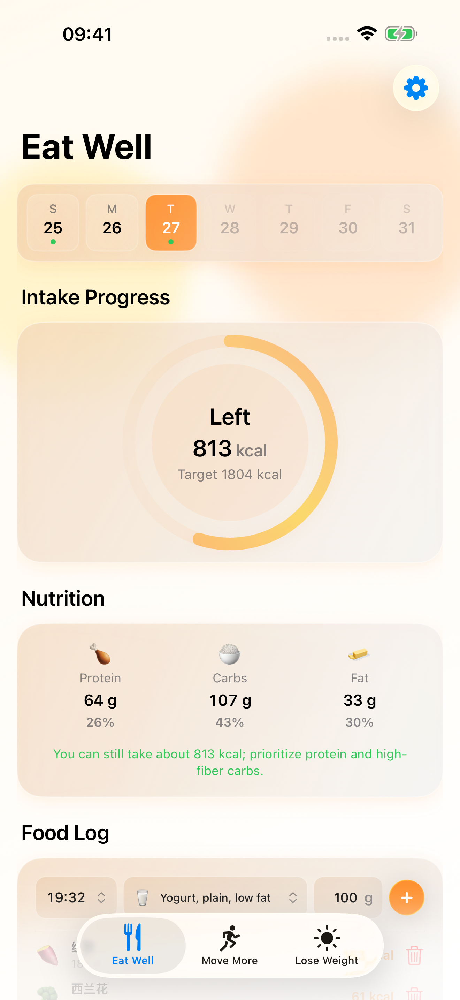
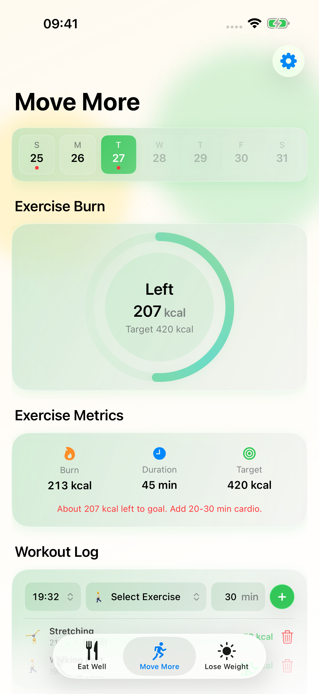
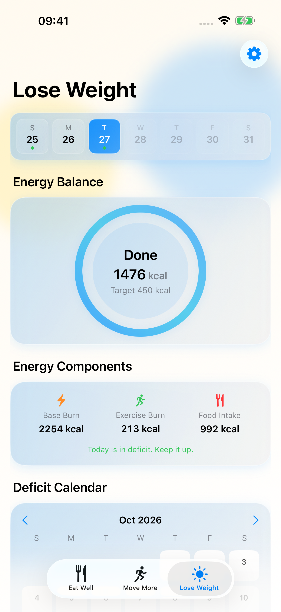

  

<h1 align="center">KeepFit</h1>

<strong>Eat well. Move more. See your everyday progress.</strong>

Log your meals, workouts, and changes in your body. Bring intake, activity, and long-term trends together to understand your own rhythm.

  <a href="https://apps.apple.com/app/id6759662867">Download on the App Store</a> ·
  <a href="https://larryhu.com/keepfit/">Website</a> ·
  <a href="https://larryhu.com/keepfit/support/">Support</a> ·
  <a href="README.md">简体中文</a>

iPhone and iPad · iOS / iPadOS 17 or later

## Connect your everyday moments

From what you ate today to changes over time, three familiar pages help you build a continuous record.

  
  
  

Eat Well · Move More · Lose Weight

Real app screens with demonstration data.

## Keep going, your way

- **Keep a food record.** Search the built-in offline food atlas by Chinese or English names and aliases. Frequently used foods come first, with portions entered in each food's reference unit.
- **Give movement a place.** Search activities, record duration, and review progress toward your goals.
- **See changes over time.** Explore calorie-balance calendars, weight charts, and body-fat trends.
- **Find your reminder rhythm.** Set meal, exercise, and daily-summary reminders alongside personal goals and preferred units.
- **Feel comfortable, day and night.** Light and dark appearances, Chinese and English interfaces, and layouts that adapt to available width.

## Your records, your choice

Data is primarily stored on your device by default. Apple Health and iCloud sync are optional and require you to enable and authorize them.

When you use cloud meal recognition, the meal text or photo you choose to submit is sent to KeepFit and its model provider. Results are estimates for you to review and confirm. See the [privacy policy](https://larryhu.com/keepfit/privacy/).

Calorie estimates, energy expenditure, and suggestions are for everyday reference. They are not medical diagnosis or treatment advice. Consult a qualified professional about health concerns.

## Get in touch

Visit [Support](https://larryhu.com/keepfit/support/) or email [keepfit@larryhu.com](mailto:keepfit@larryhu.com). Include your device, OS and app versions, and reproduction steps. Keep personal health records and credentials private.

© 2026 Larry Hu
