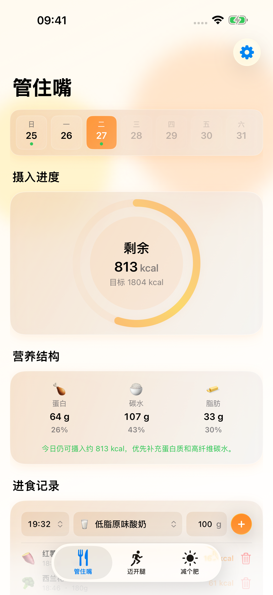
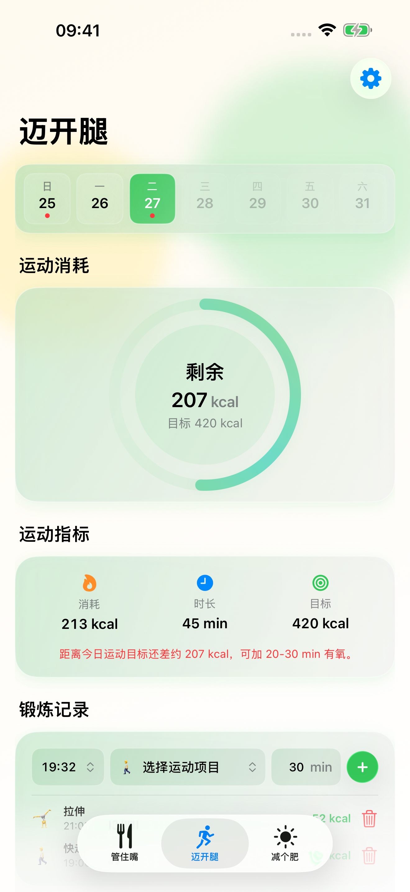
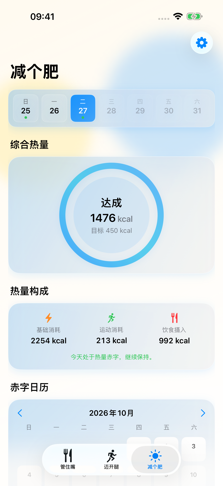

<p align="center">
  
</p>

<h1 align="center">KeepFit</h1>
<p align="center"><strong>管住嘴，迈开腿。让每一天的记录，看得见。</strong></p>
<p align="center">记饮食、记运动，也记下身体的变化。<br>把摄入、消耗和长期趋势放在一起，更了解自己的节奏。</p>

<p align="center">
  <a href="https://apps.apple.com/app/id6759662867">在 App Store 下载</a> ·
  <a href="https://larryhu.com/keepfit/">产品主页</a> ·
  <a href="https://larryhu.com/keepfit/support/">技术支持</a> ·
  <a href="README.en.md">English</a>
</p>
<p align="center">iPhone 与 iPad · iOS / iPadOS 17 及以上 · SwiftUI</p>

## 把日常，连成一条线

从今天吃了什么，到这段时间的变化。三个熟悉的页面，陪你慢慢积累。

| 管住嘴 | 迈开腿 | 减个肥 |
|:---:|:---:|:---:|
|  |  |  |
| 记录食物与份量，查看热量估算及蛋白、碳水、脂肪，用日历回顾饮食。 | 记下运动项目与时长，了解估算消耗，为日常活动留下连续的记录。 | 把热量平衡、体重和体脂趋势放在一起，拉长时间看见变化。 |

真实应用界面，截图中为演示数据。

## 用你的方式，坚持

- **饮食有记录。** 内置离线食物图谱，支持中英文名称与别名搜索；常用食物优先展示，按食物的基准单位记录份量。
- **运动有回应。** 搜索运动项目、记录时长，回顾活动与目标进度。
- **变化有迹可循。** 用热量平衡日历、体重与体脂图表观察长期趋势。
- **把提醒调成自己的节奏。** 饮食、运动与每日总结提醒，配合个人目标及单位设置。
- **白天与夜晚，都舒服。** 浅色、深色和中英文界面，布局随可用宽度调整。

## 认真记录，也尊重隐私

数据默认主要保存在设备上。Apple 健康与 iCloud 同步均可选，只有主动开启并授权后才会使用。

使用云端饮食识别时，主动提交的这餐文字或照片会发送至 KeepFit 服务器与模型服务。识别结果是估算，需要核对后确认。详情见[隐私政策](https://larryhu.com/keepfit/privacy/)。

热量、消耗和相关建议仅供日常记录参考，不构成医疗诊断或治疗建议。如有健康问题，请咨询专业人士。

## 从源码开始

使用 Xcode 打开 `120_App/KeepFit.xcodeproj`，选择 **KeepFit** scheme。无需签名的模拟器构建：

```sh
DEVELOPER_DIR=/Applications/Xcode.app/Contents/Developer xcodebuild \
  -project 120_App/KeepFit.xcodeproj -scheme KeepFit \
  -sdk iphonesimulator -derivedDataPath /tmp/keepfit-build \
  CODE_SIGNING_ALLOWED=NO build
```

| 目录 | 内容 |
|---|---|
| [120_App](120_App/) | SwiftUI App、Xcode 工程和测试 |
| [121_FoodAtlas](121_FoodAtlas/) | 食物图谱整理、来源追踪和离线导出工具 |
| [122_Backend](122_Backend/) | 饮食识别后端、工作台与部署说明 |
| [123_AppStore](123_AppStore/) | 上架文案、素材源文件和重制工具 |
| [124_Design](124_Design/) | 设计资料与图标映射 |
| [125_Docs](125_Docs/) | 开发说明、支持、隐私与版本记录 |
| [126_Tools](126_Tools/) | 媒体工具依赖清单 |

详见[开发与维护说明](125_Docs/README.md)、[App 测试](120_App/Tests/README.md)和[食物图谱说明](121_FoodAtlas/README.md)。私有数据库、凭据、签名、审核联系人及大型素材中间文件不包含在仓库中。App 已包含可直接加载的离线食物数据包。

源码版本与更新说明见 [GitHub Releases](https://github.com/LarryHu1988/KeepFit/releases)。App Store 可下载版本以商店页面为准。

## 联系

问题与建议欢迎提交 [Issue](https://github.com/LarryHu1988/KeepFit/issues)，或联系 [keepfit@larryhu.com](mailto:keepfit@larryhu.com)。反馈时请附设备型号、系统与 App 版本，以及复现步骤；请勿公开个人健康记录或凭据。

© 2026 Larry Hu。仓库公开供查看，尚未授予统一的开源许可；第三方资料遵循各自许可与使用条款。
